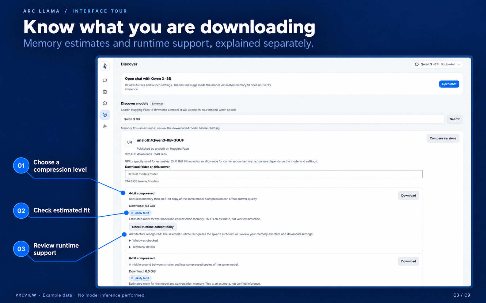

[← Previous](02-discover.md) · **3 / 9** · [Next →](04-review.md)

# Know what you are downloading

Compare compression levels and estimated memory fit, then check whether the selected runtime recognizes the model architecture. Architecture recognition does not verify its encoding or inference.

Development UI preview captured on 2026-10-22 with synthetic data. [Annotated slide](images/03-compatibility.png) · [Original capture](originals/03-compatibility.png).

[← Previous](02-discover.md) · [All screenshots](README.md) · [Next →](04-review.md)
