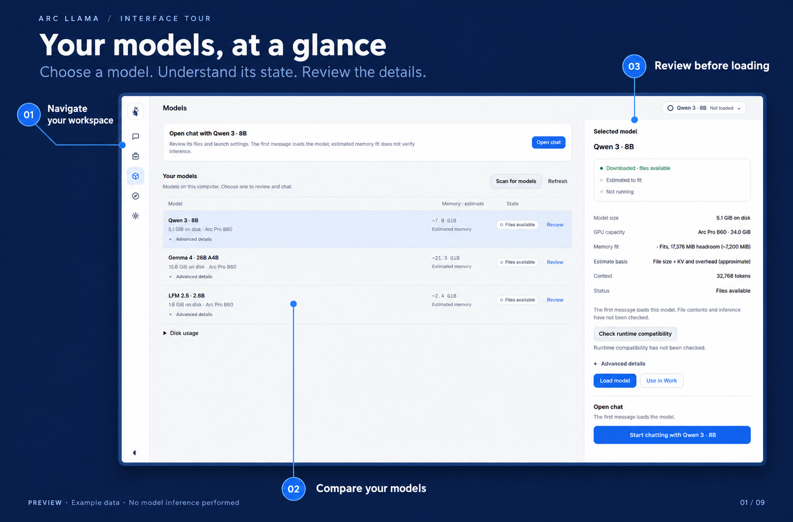
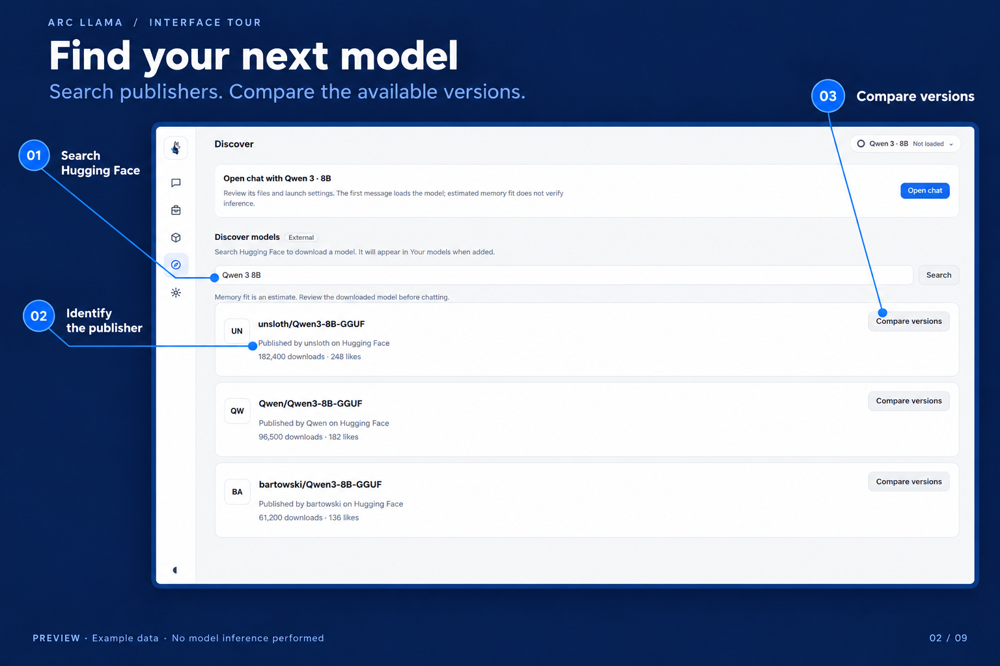
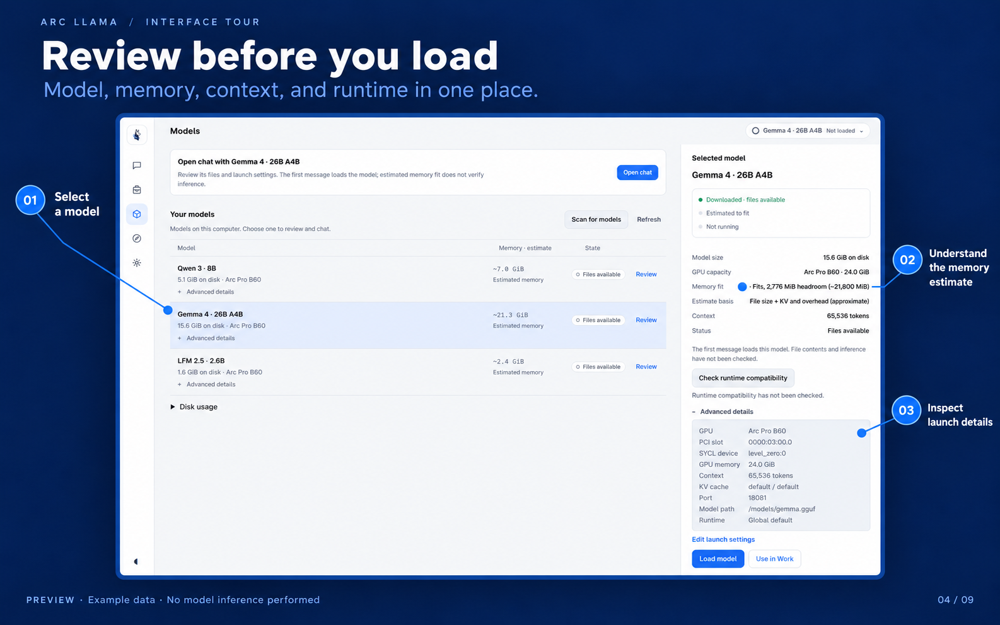
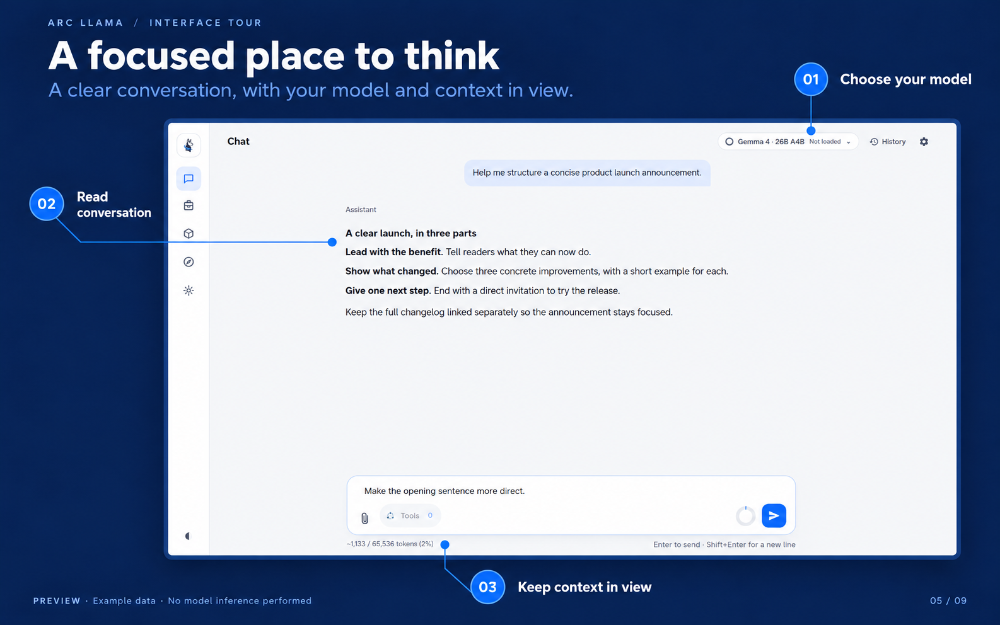
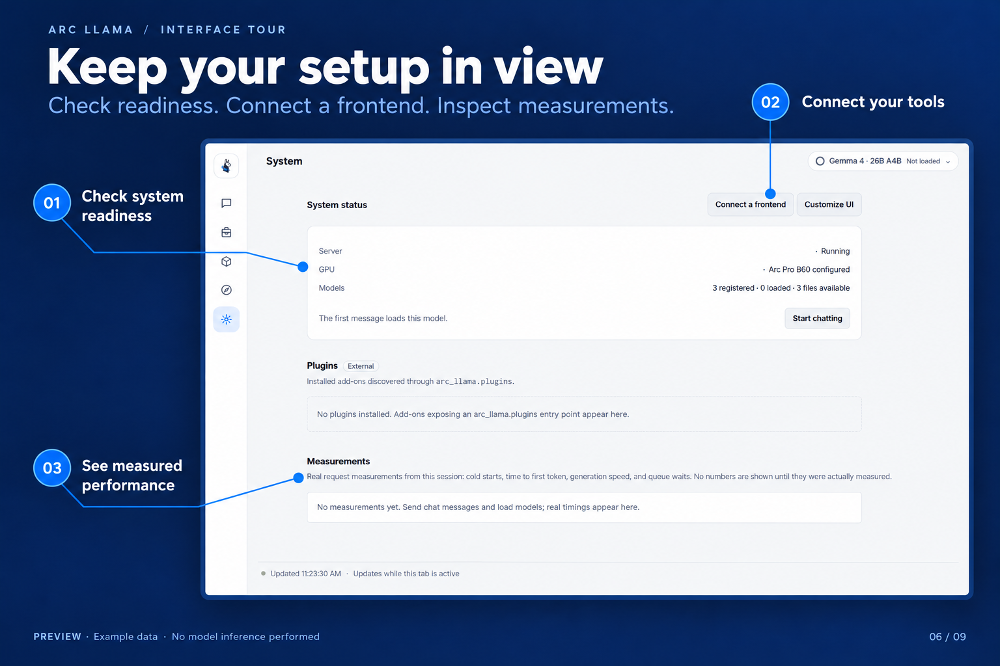
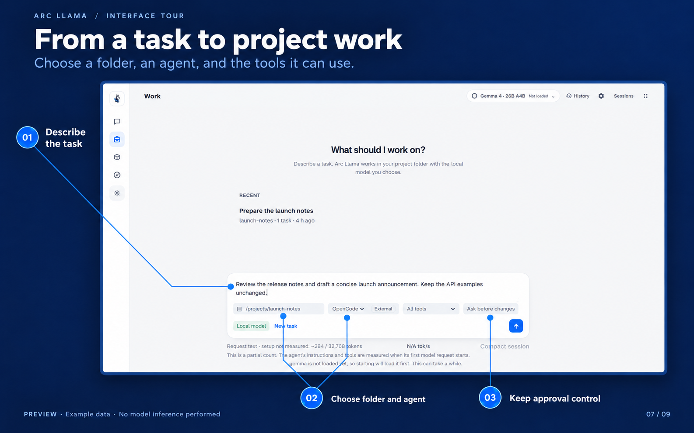
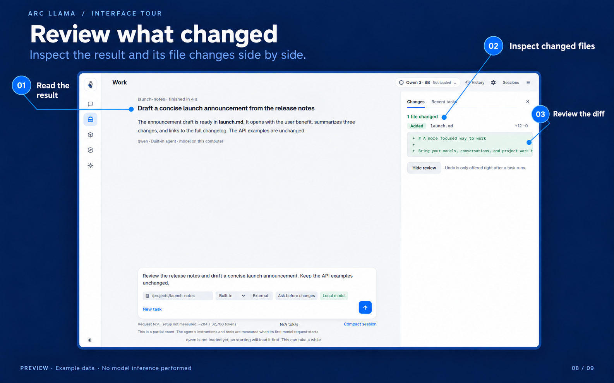
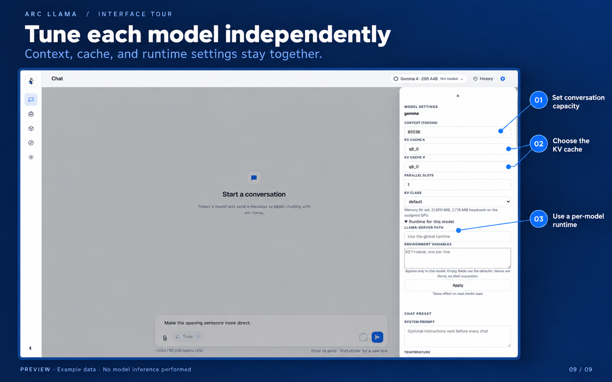

# A quick look at Arc Llama

A nine-screen tour of the current Work development UI: Models, Discover,
Compatibility, Model review, Chat, System, Work, Change review, and Runtime settings.
The captures include pending local UI work and are not a guarantee that every
pictured control is available in the branch tip or published 0.9.1.2 package.

**[Start the click-through tour →](01-models.md)** · [Open the interactive gallery](index.html)

| [Models](01-models.md) | [Discover](02-discover.md) | [Compatibility](03-compatibility.md) |
| --- | --- | --- |
|  |  |  |

| [Model review](04-review.md) | [Chat](05-chat.md) | [System](06-system.md) |
| --- | --- | --- |
|  |  |  |

| [Work](07-work.md) | [Change review](08-work-review.md) | [Runtime settings](09-settings.md) |
| --- | --- | --- |
|  |  |  |

## Interactive gallery

[index.html](index.html) displays the nine annotated slides with a full-size viewer,
keyboard navigation, and a toggle for the original, unannotated capture. Open it
locally with the adjacent `images/` and `originals/` directories, or serve the
folder as a static site. GitHub's file view does not execute HTML; the Markdown
slides above work directly on GitHub. No hosting or GitHub Pages deployment is
configured by this update.

## Capture notes

- Captured on 2026-10-22 from an isolated static snapshot of the development UI.
- API responses, model inventory, publisher statistics, Chat messages, Work task
  results, and example paths are synthetic. Personal history and credentials
  were not accessed or included.
- No local inference, agent execution, model loading/stopping, or GPU benchmarking
  was performed. The System view intentionally has no performance measurements.
- The image model added the presentation frames and numbered callouts. Original
  captures are supplied for exact UI and text reference.
- Per-model runtime controls shown in the final slide reflect pending local work.
- Images and PNG metadata were checked for personal identifiers and credentials.
  Paths such as `/projects/launch-notes` and `/models/gemma.gguf` are examples.
- Refresh these captures when the visible interface changes. Keep example-data
  labels and avoid exposing personal paths, tokens, or conversation contents.
